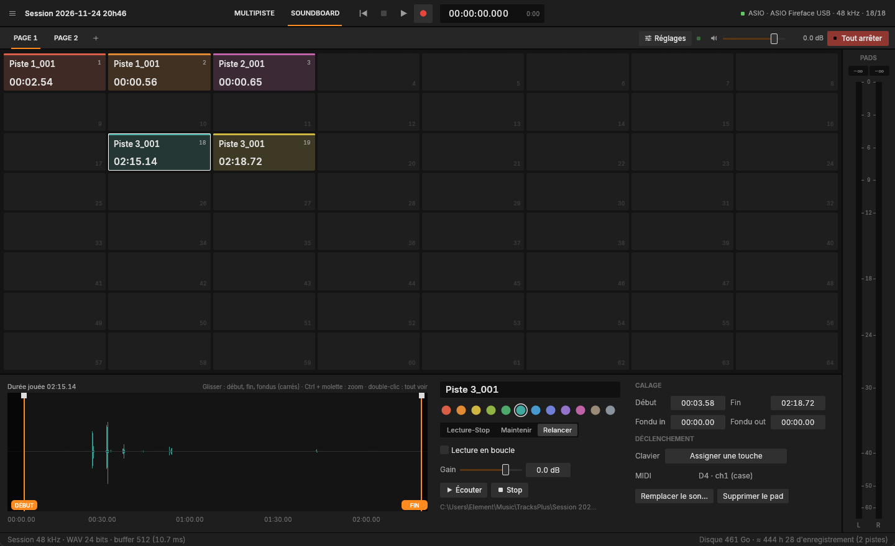

# TracksPlus

Enregistreur **multipiste** et **soundboard** dans une seule application. Interface sombre,
plate et dense, dans l'esprit des stations audio modernes (Bitwig) : gris anthracite, accent
orange, angles quasi droits, couleurs de pistes désaturées.
Pensé pour le live : Dante Virtual Soundcard (jusqu'à 64 entrées et plus), ASIO, CoreAudio.

| Multipiste | Soundboard |
| --- | --- |
|  |  |

## Onglet Multipiste

- **Carte son** : pilote (ASIO / WASAPI, CoreAudio, ALSA / JACK), entrée, fréquence, buffer, et
  **toutes les sorties au même endroit** : multipiste, soundboard et monitoring, chacune sur
  n'importe quelle paire de n'importe quel périphérique (ou « Comme le multipiste »).
  Configuration mémorisée : on retrouve sa carte Dante au lancement. Après un changement
  de buffer ou de fréquence dans le panneau du pilote (RME, Focusrite…), **« Actualiser »**
  dans « Carte son » rouvre la carte et reprend ces réglages (en ASIO, buffer et fréquence
  repassent en « Auto »). Indisponible pendant une prise.
- **Fenêtre** : 1280 × 720 minimum (à l'échelle d'affichage 100 % de Windows).
- **Pistes** : « Ajouter une piste » → **Mono** ou **Stéréo**, puis l'entrée (un clic crée la
  piste). Mono = une entrée ; stéréo = une paire fixe (1-2, 3-4…) enregistrée dans un seul WAV
  stéréo. Sélecteur en grille (1 à 64+, entrées déjà utilisées signalées), réglable ensuite
  depuis l'étiquette « IN » de la piste (mono / stéréo et entrée).
  Armement, **monitoring direct** (casque : l'entrée de la piste est écoutée en temps réel sur
  la sortie « Monitoring »), **M**ute / **S**olo pour la lecture, renommage par double-clic.
- **Vumètres pro** : crête façon IEC 60268-18 (échelle dB non linéaire, plus précise près de 0),
  zones vert / jaune (−12 dB) / rouge (−3 dB), maintien de crête, valeur crête max en dB et
  voyant de saturation (clic pour remettre à zéro). Un vumètre par piste, un **vumètre master**
  stéréo, et un **bandeau de vumètres** affichant toutes les entrées d'un coup.
- **Enregistrement** : WAV mono 24 bits ou 32 bits flottant écrit directement sur disque
  (en-têtes mis à jour toutes les 2 s : fichiers lisibles même après un crash), sauvegarde
  automatique à chaque stop, temps d'enregistrement restant sur le disque, écoute des pistes
  existantes pendant la prise.
- **Navigation** : la timeline **suit** la tête de lecture en continu ; si vous faites défiler
  pendant la lecture ou l'enregistrement, le suivi se met en pause 3 s puis recadre
  automatiquement (y compris verticalement sur les pistes en cours d'enregistrement).
  Clic sur la règle / une piste = se déplacer (même en lecture). **Glisser sur les pistes =
  rectangle de sélection des prises** (Ctrl / Maj pour ajouter) ; **glisser sur la règle =
  sélection de temps** (export ou suppression d'une plage). Touches **1 à 9** = aller au
  repère 1 à 9. Double-clic sur une prise = sélectionner sa durée, barre de défilement.
- **Montage** : cliquer une prise pour la sélectionner (Ctrl pour en ajouter), la **glisser**
  pour la déplacer (y compris vers une autre piste), **rogner** en tirant ses bords,
  **couper** à la tête de lecture (S), **supprimer** (Suppr) les prises sélectionnées ou tout le
  contenu d'une plage de temps. **Magnétisme** sur la tête de lecture, les repères, la sélection
  et les bords des autres prises (Maj pour le désactiver). **Annuler / Rétablir** (Ctrl+Z,
  Ctrl+Maj+Z). Le montage est non destructif : les fichiers enregistrés ne sont jamais modifiés.
- **Fondus sur les prises** : poignées blanches aux coins supérieurs de chaque prise à tirer
  pour régler le fondu d'entrée et de sortie (courbe en S, sans clic), ou clic droit →
  fondus 10 ms / 100 ms / 1 s sur la sélection. Deux prises qui se chevauchent avec un fondu
  font un fondu enchaîné. Les fondus s'appliquent à l'écoute comme à l'export.
- **Repères** (touche M, même pendant l'enregistrement) : clic = y aller ; clic droit ou
  double-clic sur l'étiquette = renommer, supprimer, sélectionner
  jusqu'au repère suivant, flèches ← / → pour sauter de repère en repère.
- **Export** : pistes **choisies une à une** (ou la sélection de la timeline), toute la
  session ou **seulement la plage sélectionnée**, pistes séparées (stéréo pour les pistes stéréo) et/ou mix stéréo,
  44.1 / 48 / 88.2 / 96 kHz, 16 bits (dither TPDF) / 24 bits / 32 bits entier / 32 bits flottant.

## Onglet Soundboard

- **Pads** en grille, jusqu'à 8 pages. Sans contrôleur reconnu, la grille se choisit dans
  les réglages (4×2 à 8×8) ; avec un contrôleur reconnu, elle prend sa taille (voir
  « Disposition automatique »). Glissez-déposez des fichiers (WAV, AIFF, MP3, AAC/M4A, FLAC,
  OGG) sur une case, ou cliquez sur une case vide. Déclenchement à l'appui (pas au
  relâchement) pour la réactivité.
- **Pads plus larges que hauts** : titre sur plusieurs lignes, et durée en gros, alignée sur
  le titre, au format `mm:ss.cc` (deux chiffres partout ; temps restant pendant la lecture).
  **Double-clic sur un pad (ou clic droit → Renommer) pour le renommer** directement dans la
  grille (Entrée valide, Échap annule).
- **Trois modes**, réglés pad par pad dans l'éditeur (nouveau pad : **Relancer**) :
  - **Lecture-Stop** : un appui lance le son, un nouvel appui l'arrête ;
  - **Maintenir** : le son joue tant que le pad (touche, pad MIDI ou Ctrl + clic) est tenu
    et s'arrête au relâchement ;
  - **Relancer** : chaque appui repart du début, même si le son joue déjà.
  Option de lecture en boucle.
- **Éditeur** (en bas, toujours affiché : la grille ne change pas de taille quand on clique
  un pad) : forme d'onde zoomable, poignées **début / fin**, poignées de **fondu d'entrée et
  de sortie** (courbes douces), gain en dB, couleur, nom, touche clavier et MIDI du pad.
- **Contrôleur USB** : choix du port MIDI (ou tous), déclenchement direct dans le thread
  audio : fonctionne même fenêtre réduite. En disposition manuelle, **MIDI learn** par pad
  (notes et CC). **Touches clavier** assignables par pad (pratique aussi avec un Stream
  Deck). Le code MIDI d'un pad s'affiche dans l'éditeur, pas sur la grille.
- **Disposition automatique** (par défaut) : quand le contrôleur choisi dans les réglages est
  un modèle reconnu, la grille prend **sa taille et sa disposition**, sans MIDI learn : **le
  MIDI appartient à la case**, pas au son. Glisser un son dans une case le fait jouer par le
  pad au même endroit (qui s'allume s'il a des LED), sur la page affichée. Débrancher le
  contrôleur rend la grille choisie dans les réglages. Avec « Tous les ports MIDI », le
  premier contrôleur reconnu est utilisé. La disposition « Manuelle » garde le MIDI learn
  pad par pad (pour les autres contrôleurs, ou pour tout régler soi-même).

  | Contrôleur | Grille | Pages depuis le contrôleur | LED |
  | --- | --- | --- | --- |
  | Novation Launchpad MK2, X, Mini MK3, Pro, Pro MK3 | 8 × 8 | colonne de droite (1 à 8) | couleur du pad |
  | Novation Launchpad S, Mini mk1 / mk2 | 8 × 8 | colonne de droite (1 à 8) | ambre / vert |
  | Akai APC mini mk2 | 8 × 8 | colonne de droite (1 à 8) | couleur du pad |
  | Akai APC mini | 8 × 8 | colonne de droite (1 à 8) | jaune / vert |
  | Ableton Push 2 | 8 × 8 | boutons de scène (1 à 8) | blanc / vert |
  | Akai APC Key 25 mk2 | 5 × 8 | Scene Launch (1 à 5) | couleur du pad |
  | Akai APC Key 25 | 5 × 8 | Scene Launch (1 à 5) | jaune / vert |
  | Akai APC40 mkII | 5 × 8 | Scene Launch (1 à 5) | couleur du pad |
  | Akai Fire | 4 × 16 | boutons Mute / Solo des lignes (1 à 4) | — |
  | Akai MPD218 | 4 × 4 (banque A) | — | — |
  | Novation Launchkey MK3, Mini MK3, MK4 | 2 × 8 (mode Drum) | — | — |
  | Korg nanoPAD2 | 2 × 8 (scène 1) | — | — |
  | Akai MPK mini mk3 | 2 × 4 (banque A) | — | — |
  | Arturia MiniLab 3 | 1 × 8 (banque A) | — | — |

  Les contrôleurs sont utilisés dans leur réglage d'usine. Les Launchpad récents passent
  seuls en mode « Programmer », l'APC40 mkII en mode « Ableton » (LED pilotées), le Push 2 en
  mode « User » s'il est branché sur son port User. Sans boutons de page, les pages se
  changent à l'écran. Ports à choisir : pour l'APC Key 25 mk2, le second port (celui des
  pads) ; pour les Launchkey, le port principal (pas « MIDIIN2 »).
- **LED du contrôleur** : les pads qui ont un son s'allument, sans clignoter : couleur du
  pad faible quand un son y est chargé, forte pendant la lecture (voir le tableau). En
  disposition manuelle, ce sont les pads associés en MIDI qui s'allument (on/off pour les
  contrôleurs non reconnus). Détection automatique du modèle et de la sortie MIDI
  correspondante, réglable dans le menu « LED ».
- **À la souris** : un clic sélectionne le pad (réglages dans l'éditeur), un glissé le range
  sur une autre case (échange si elle est occupée) ou sur un onglet de page pour l'y envoyer.
  **Ctrl + clic joue le pad** (pour tester sans contrôleur, selon son mode). Les sons se
  jouent aussi au clavier, au contrôleur MIDI, ou avec « Écouter » dans l'éditeur (repart
  toujours du début).
- **Sortie dédiée** (ex. sorties 3–4 de la Dante), volume général, vumètre stéréo des pads,
  **Tout arrêter** avec fondu (Échap). Le soundboard est sauvegardé automatiquement et peut
  être enregistré / rechargé comme fichier.

## Fiabilité en live

Conçu pour ne jamais perdre une prise :

- **Écriture directe sur disque** par un thread dédié, tampon de 4 s par piste ; le callback
  audio n'alloue ni ne libère jamais de mémoire et ne prend aucun verrou. Testé à 64 pistes
  48 kHz en temps réel sans aucune perte.
- **Si le disque prend du retard**, les trames manquantes sont remplacées par du silence au
  même endroit : la piste ne se décale jamais par rapport aux autres. Alerte immédiate.
- **En-têtes WAV mis à jour toutes les 2 s, données forcées sur le disque toutes les 10 s.**
- **Prises longues** : au-delà de 2 Go, la prise continue sans coupure dans `nom_p2.wav`,
  `nom_p3.wav`… (un WAV ne peut pas dépasser 4 Go), posés bout à bout dans la session.
- **Récupération après crash ou coupure** : la session et un journal des prises sont écrits
  avant le lancement de l'enregistrement. Si l'application est tuée en pleine prise, elle
  rouvre la session au redémarrage, répare les fichiers (en-têtes recalés sur la taille
  réelle) et replace les prises sur la timeline.
- **À l'arrêt**, tout ce qui reste dans les tampons est écrit, les fichiers sont fermés et la
  session sauvegardée immédiatement.
- **Pas d'arrêt accidentel** : pendant une prise, Espace / R / le bouton Rec demandent une
  confirmation (second appui) ; fermer la fenêtre demande confirmation ; changer de carte son
  ou exporter est bloqué.
- **Alertes en direct** (bandeau rouge) : plus de signal de la carte (horloge Dante, câble),
  erreur disque, disque presque plein, saturation disque, erreur du pilote.
- **Pas de mise en veille** de l'ordinateur pendant une prise.
- **Une seule instance** : relancer TracksPlus déjà ouvert affiche un message et ramène la
  fenêtre existante (deux instances se disputeraient la carte son).
- **Décrochages** signalés par le pilote audio : comptés seulement pendant une prise ou une
  lecture (remis à zéro à chaque prise) et rappelés à l'arrêt de la prise.
- **Une erreur d'interface n'arrête jamais l'audio** (rattrapée, journalisée dans
  `crash.log` du dossier de configuration). Sauvegarde automatique du montage toutes les 30 s.
- Sons du soundboard limités à 30 min (chargés en mémoire).

## Raccourcis

| Touche | Multipiste | Soundboard |
| --- | --- | --- |
| Espace | Lecture / Stop (pendant une prise : deux appuis) | |
| R | Enregistrer (pendant une prise : deux appuis pour arrêter) | |
| M | Ajouter un repère | |
| ← / → | Repère précédent / suivant | |
| 1 … 9 | Aller au repère 1 … 9 | |
| Origine / Entrée | Début (ou début de la sélection) | |
| F | Tout afficher | |
| S | Couper à la tête de lecture | |
| Suppr | Supprimer la sélection | |
| Ctrl + Z / Ctrl + Maj + Z | Annuler / Rétablir | |
| Échap | Effacer les sélections | Tout arrêter (pendant un renommage : l'annuler) |
| Ctrl + clic | Ajouter une prise à la sélection | Jouer le pad |
| Double-clic | Renommer une piste / un repère | Renommer le pad |
| Ctrl + molette | Zoom | Zoom de l'éditeur |
| Maj + molette | Défiler dans le temps | |
| Ctrl + 1 / Ctrl + 2 | Changer d'onglet | Changer d'onglet |
| Ctrl + S / Ctrl + E | Enregistrer / Exporter | |

## Utilisation avec Dante

1. Réglages carte son (pastille en haut à droite) → pilote **ASIO** (Windows) ou **CoreAudio**
   (macOS) → **Dante Virtual Soundcard**. Fréquence identique à Dante Controller.
2. Multipiste : « Ajouter une piste » (mono ou stéréo) pour chaque entrée, renommez, armez, ⏺.
3. Soundboard : choisissez la paire de sorties Dante dédiée aux pads.

## Compiler

Prérequis : [Rust](https://rustup.rs) stable. Les builds se font en local (pas de CI GitHub) :

| Script | Rôle |
| --- | --- |
| `scripts/check.sh` | « CI » locale : formatage, lint strict, tests, test de charge 64 pistes temps réel, build release Linux, compilation Windows et macOS |
| `scripts/package-windows.ps1` | **À distribuer** — sous Windows : `dist/TracksPlus-Setup-<version>.exe` (installeur : menu Démarrer, raccourci bureau, désinstallation) et `dist/TracksPlus-<version>-windows-portable.zip`, avec ASIO et WASAPI, exécutable autonome. Prérequis : Visual Studio Build Tools (C++), `winget install LLVM.LLVM` et `winget install JRSoftware.InnoSetup`. Le SDK ASIO est téléchargé automatiquement |
| `scripts/build-windows.sh` | Depuis Linux : `dist/TracksPlus.exe` **avec ASIO** (Dante VSC), autonome (aucune DLL à installer). Prérequis : `apt install mingw-w64 clang`, `rustup target add x86_64-pc-windows-gnu`. Le SDK ASIO est récupéré automatiquement |
| `scripts/build-macos.sh` | Sur un Mac : `dist/TracksPlus.app` universelle (Apple Silicon + Intel) |

Sous Windows avec Visual Studio, `cargo build --release --features asio` fonctionne aussi
(variable `CPAL_ASIO_DIR` vers le SDK ASIO). Linux : `cargo build --release` (paquet
`libasound2-dev`). Le workflow GitHub (`.github/workflows/build.yml`) ne se lance plus qu'à
la main.

Licences : police [Inter](https://rsms.me/inter/) (OFL, `assets/fonts`) ; SDK ASIO de
Steinberg en double licence GPLv3 / licence Steinberg (à signer, gratuite, pour distribuer
une version non GPL) ; `vendor/asio-sys` est une copie d'asio-sys (Apache-2.0) avec une
seule modification pour la compilation MinGW.

## Architecture

| Fichier | Rôle |
| --- | --- |
| `src/audio.rs` | Périphériques, flux cpal, callbacks temps réel (sans allocation ni verrou), vumètres |
| `src/sampler.rs` | Moteur des pads (voix, fondus, modes) exécuté dans le callback de sortie |
| `src/soundboard.rs` | Modèle du soundboard, décodage (symphonia) et rééchantillonnage des sons |
| `src/midi.rs` | Contrôleurs MIDI : dispositions des modèles reconnus, LED, déclenchement direct vers le moteur audio |
| `src/recorder.rs` / `src/player.rs` | Threads disque : enregistrement et lecture multipiste |
| `src/render.rs` / `src/export.rs` | Lecture des prises, formes d'onde, export |
| `src/project.rs` | Session, pistes, prises, repères |
| `src/app.rs`, `src/ui/*` | Interface (egui) : thème, widgets, onglets |
