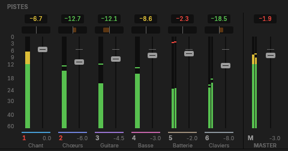
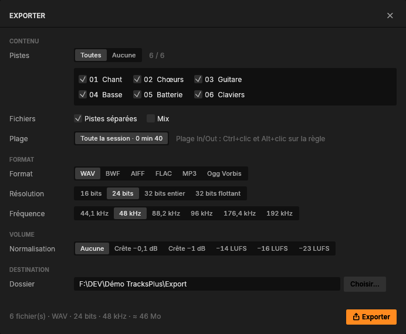
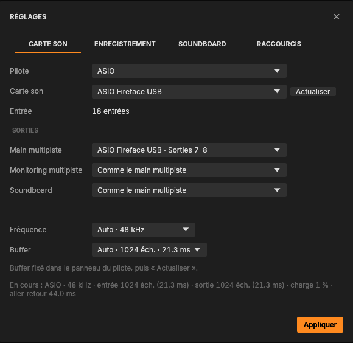
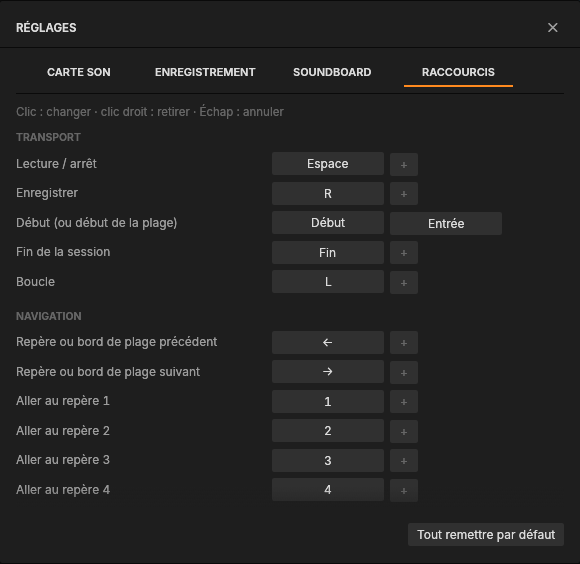

# TracksPlus

Enregistreur **multipiste** et **soundboard** pour le live, dans une seule application.
Fonctionne avec Dante Virtual Soundcard (64 entrées et plus), ASIO, WASAPI et CoreAudio.

| Multipiste | Soundboard |
| --- | --- |
|  |  |

## Installation et mises à jour

- Page [Releases](https://github.com/ElementV2/tracksplus/releases) :
  `TracksPlus-Setup-<version>.exe` (Windows 10/11 64 bits, aucun prérequis) ou la version
  portable `…-windows-portable.zip`.
- Au premier lancement, Windows SmartScreen peut afficher « Windows a protégé votre
  ordinateur » → « Informations complémentaires » → « Exécuter quand même ».
- Quand une nouvelle version est publiée, une pastille **« Version x.y.z »** apparaît en haut
  à droite et sur l'écran d'accueil (et un point orange sur le menu ···). Elle affiche les
  nouveautés et le bouton
  **« Installer et redémarrer »** : TracksPlus se met à jour et se relance, réglages et
  sessions conservés. Indisponible pendant une prise.
- « Ignorer cette version » ne la propose plus. Menu ··· → « Rechercher des mises à jour »
  pour vérifier à la main ; la recherche au lancement est désactivable. La version portable
  ouvre la page de téléchargement.
- Fenêtre de 940 × 600 minimum (tient dans une moitié d’écran ancrée par Windows).

## Au lancement

- Un écran d'accueil propose de **reprendre la dernière session**, d'en **créer** une,
  d'en **ouvrir** une, ou de choisir dans la **liste des sessions** (date, nombre de pistes
  et de prises, durée, recherche par nom).
- Après un crash pendant une prise, la session interrompue se rouvre directement.

## Sessions

Une session est un dossier (par défaut `Musique\TracksPlus\<session>`), à copier, déplacer
ou archiver d'un bloc :

```
<session>\
├── <session>.tracksplus   pistes, prises, montage, repères
├── soundboard.json        pages et pads du soundboard
├── Audio\                 prises enregistrées (jamais modifiées)
├── Sons\                  sons du soundboard
└── Export\                fichiers exportés
```

- Chaque session a son propre soundboard. Un son ajouté à un pad est copié dans `Sons\`.
- Carte son, sorties, contrôleur MIDI, LED, disposition du soundboard et mises à jour sont
  communs à toutes les sessions.
- Menu ··· : Nouvelle session…, **Ouvrir une session…** (explorateur intégré, les dossiers de
  session y apparaissent comme des sessions), Enregistrer (Ctrl+S), Enregistrer sous… (copie
  aussi le soundboard et ses sons, sans écraser une session existante), Afficher le dossier,
  Exporter… (Ctrl+E), format d'enregistrement, **Importer un soundboard…** (reprend les pads
  et les sons d'un autre soundboard), **Nettoyer les fichiers inutilisés…**, Réglages…
  (Ctrl+,), mises à jour.
- **Nettoyer les fichiers inutilisés** : les prises qui ne servent plus (pistes ou prises
  supprimées) sont listées avec leur taille, puis envoyées à la **Corbeille** de Windows,
  aussi sur le second disque de la copie de sécurité. Les fichiers encore utilisés, même par
  un morceau de prise, ne sont jamais touchés. Après le nettoyage, Ctrl+Z ne peut plus
  ramener ce qui a été supprimé avant.

## Multipiste

### Pistes et enregistrement

- Bouton **+** au-dessus des pistes : nombre de pistes, **Mono** ou **Stéréo** (paire fixe
  1-2, 3-4… dans un seul fichier), première entrée, nom.
- La flèche à gauche du nom déplie la piste : type, entrée (grille, entrées déjà utilisées
  signalées), couleur. Armement, **monitoring direct** (sortie « Monitoring multipiste »),
  **M**ute / **S**olo, renommage par double-clic.
- Plusieurs pistes sélectionnées à gauche : clic droit → **« Supprimer les N pistes »**
  (Ctrl+Z les ramène).
- Enregistrement en WAV (BWF) 24 bits ou 32 bits flottant (menu ···), signal brut de la carte,
  sauvegarde à chaque stop. Temps restant sur le disque en bas à droite, calculé pour les
  pistes armées.
- **Enregistrer par-dessus** : les autres pistes jouent pendant la prise ; une piste qui
  enregistre fait entendre son entrée, jamais l'ancienne prise qu'elle recouvre (gardée
  dessous, retrouvée à la lecture).
- À l'arrêt, les **prises qui viennent d'être enregistrées sont sélectionnées** : Suppr pour
  la refaire, Ctrl+Z pour la ramener.
- **Vumètres** crête IEC 60268-18 : vert / jaune (−12 dB) / rouge (−3 dB), maintien, valeur
  crête en dB (−∞ sans signal), voyant de saturation rouge jusqu'au clic. Un par piste, un
  master stéréo, et un bandeau de toutes les pistes : niveau de lecture pendant la lecture,
  niveau d'entrée des pistes armées à l'arrêt et pendant la prise.
- **Mixage** (bandeau des vumètres) : un fader et un panoramique par piste, et un fader
  master. Double-clic : 0 dB ou centre ; Maj : réglage fin. Piste mono au centre à −3 dB
  de chaque côté, comme sur une console. Les prises ne sont jamais modifiées : les faders
  règlent l'écoute et le mix exporté (les fichiers de piste exportés restent bruts).



### Pistes audio (musique, sons)

- Glisser des fichiers audio (WAV, AIFF, MP3, FLAC, Ogg, M4A) depuis l'explorateur sur le
  multipiste : **une piste audio par fichier**, la prise posée à l'endroit du dépôt (à la
  tête de lecture si on lâche sur la colonne des pistes). Un fichier lâché sur une piste
  audio existante s'y ajoute.
- Les fichiers sont convertis à la fréquence de la session et copiés dans `Audio\` ; les
  originaux ne sont jamais modifiés. Progression et « Annuler » pendant la conversion ;
  chaque fichier refusé est signalé avec la raison. Ctrl+Z retire les pistes ajoutées.
- Une piste audio est en lecture seule : pas d'entrée, pas d'enregistrement ni de monitoring,
  mono ou stéréo selon ses fichiers. Son vumètre montre le **niveau de lecture** (une barre
  par canal). Montage, fondus, M / S et export comme les autres pistes.

### Navigation

- La timeline suit la tête de lecture ; après un défilement manuel, le suivi reprend au bout
  de 3 s.
- Clic sur la règle ou une piste : déplacer la tête de lecture. Glisser sur la règle : faire
  défiler (sur la tête de lecture : la déplacer).
- **Plage In/Out** : Ctrl + clic sur la règle = entrée, Alt + clic = sortie, ou **I** / **O**
  à la tête de lecture. Échap (ou la gomme de la barre d'outils) l'efface.
- **Boucle** (bouton boucle du transport, ou **L**) : la lecture tourne en boucle sur la plage, sans trou
  au retour au début ; la plage s'affiche avec une barre orange sur la règle.
- Glisser sur les pistes : rectangle de sélection (Ctrl / Maj pour ajouter). Double-clic sur
  une prise : sélectionner sa durée.
- **← / →** : de repère en repère, en s'arrêtant aussi au début et à la fin de la plage
  sélectionnée. **1 à 9** : aller au repère 1 à 9 (aussi sur un clavier AZERTY, sans Maj).
- **Barre d'outils** (bulle d'aide avec le raccourci) : suivre la lecture (Ctrl+F),
  magnétisme (G) · repère, entrée `[`, sortie `]`, effacer la plage · couper, supprimer ·
  annuler, rétablir · mixage et vumètres (V) ; à droite, exporter.

### Montage et repères

- Clic sur une prise : la sélectionner (Ctrl pour ajouter). Glisser : la déplacer, aussi vers
  une autre piste (affichée en direct sur la piste visée). Tirer ses bords : la rogner.
- Clic droit sur des prises sélectionnées : **« Sélectionner la plage des N prises »** (de la
  première à la dernière), **« Exporter les N prises… »** (export avec leurs pistes et leur
  plage), fondus, supprimer.
- **S** coupe à la tête de lecture (les prises sélectionnées, sinon toutes celles sous la
  tête) ; **Suppr** supprime la sélection ou le contenu de la plage.
- **Magnétisme** (bouton aimant ou **G**, désactivé au lancement) : les prises, la tête de
  lecture et la plage se calent sur les temps de la grille (par pas réguliers), les repères
  et la tête de lecture. **Maj** enfoncée pendant un glissement l'inverse (aimante quand il
  est coupé, libère quand il est actif).
- **Fondus** : poignées aux coins supérieurs des prises, ou clic droit → 10 ms / 100 ms / 1 s.
  Deux prises qui se chevauchent avec un fondu font un fondu enchaîné.
- Ctrl+Z / Ctrl+Maj+Z. Le montage ne modifie jamais les fichiers enregistrés.
- **Repères** : **M** (même pendant une prise). Clic : y aller ; clic droit ou double-clic :
  renommer, supprimer, sélectionner jusqu'au suivant. ← / → et **1 à 9** pour y sauter.
- Tous les raccourcis se changent dans Réglages → Raccourcis.

## Export



Chaque option a une bulle d'aide avec un exemple.

- **Contenu** : pistes choisies une à une (ou celles sélectionnées à gauche), toute la
  session, la **plage In/Out** ou les **prises sélectionnées** (clic droit → « Exporter les N
  prises… ») ; **stems** (stéréo pour les pistes stéréo) et/ou **mix stéréo ou mono**.
  « Toute la session » donne des fichiers de la durée de la session, silence compris : posés
  au même départ dans un autre logiciel, ils restent synchronisés.
- **Formats** : **WAV** (RF64 au-delà de 4 Go), **BWF** (horodaté, se recale seul en
  post-production), **AIFF** (4 Go maximum), **FLAC**, **MP3** (128 à 320 kbit/s ou VBR V0,
  tags ID3), **Ogg Vorbis** (qualité 5, 7 ou 9).
- **Résolution** 16 bits (avec dither), 24 bits, 32 bits entier ou flottant selon le format ;
  **fréquence** 44,1 à 192 kHz (48 kHz maximum en MP3 et Ogg).
- **Normalisation** par fichier : crête −0,1 ou −1 dB, ou −14 LUFS (streaming), −16 LUFS
  (podcast), −23 LUFS (EBU R128), crête vraie sous −1 dBTP.
- Résumé avant export : nombre de fichiers, format, **taille estimée**.

## Soundboard

### Pads

- Grille de pads, jusqu'à 8 pages, de 4×2 à 8×8 (ou la taille du contrôleur reconnu).
- Ajouter un son : glisser-déposer un fichier (WAV, AIFF, MP3, AAC/M4A, FLAC, OGG, 30 min
  maximum) sur une case, ou cliquer sur une case vide pour ouvrir l'**explorateur de sons**
  (Sons de la session, Musique, Bureau, Documents, Téléchargements, disques ; chemin
  cliquable ; recherche ; plusieurs sons avec Ctrl / Maj ; double-clic pour ajouter ; rouvert
  dans le dernier dossier).
- Chaque pad affiche son titre et sa durée (`mm:ss.cc`, temps restant pendant la lecture).
- **Modes**, pad par pad, avec option de boucle : **Lecture-Stop** (un appui lance, le
  suivant arrête), **Maintenir** (joue tant que le pad est tenu), **Relancer** (chaque appui
  repart du début ; mode des nouveaux pads). Déclenchement à l'appui.
- **Éditeur** (en bas) : forme d'onde zoomable, poignées **début / fin** et **fondus**, gain en
  dB, couleur, nom, touche clavier, code MIDI, « Écouter » (depuis le début).
- Clic : sélectionner. **Ctrl + clic** : jouer. Glisser : ranger sur une autre case (échange
  si occupée) ou sur un onglet de page. Double-clic : renommer (Entrée / Échap). **Suppr** :
  supprimer. Clic droit : Renommer, Remplacer le son…, Écouter, Arrêter, Supprimer le pad.

### Transport et sortie

- Sur l'onglet Soundboard, la barre du haut affiche le transport des pads à la place de
  celui du multipiste : **Stop** (panique en deux temps, Échap : un premier appui éteint
  tous les pads en fondu d'une seconde, un second appui pendant le fondu les coupe net),
  voyant vert quand
  un pad joue, temps restant du dernier pad à finir, nombre de pads en lecture, pastille
  **REC** pendant une prise multipiste (clic : retour au multipiste).
- Les pads jouent à 0 dB sur la sortie Soundboard (Réglages → Carte son), chacun avec son
  gain. Vumètre stéréo des pads.
- Le soundboard est enregistré automatiquement dans la session.
- **Mode spectacle** (cadenas de la barre du soundboard) : les pads restent jouables, mais
  rien ne peut être supprimé, déplacé, remplacé ou réglé par erreur. Pas de mot de passe.
- **Anti-rebond** : sur les pads « Lecture-Stop », un second appui à moins de 150 ms (rebond
  d'un bouton MIDI, double-clic) est ignoré ; réglable dans Réglages → Soundboard (0 =
  désactivé).
- Déplacer un pad qui joue ne le coupe pas.

### Contrôleur MIDI

- Choix du port MIDI (ou tous les ports). Les pads se déclenchent même fenêtre réduite.
- **Disposition automatique** (par défaut) : avec un contrôleur reconnu, la grille prend sa
  taille et sa disposition. Le MIDI appartient à la case : un son glissé dans une case est
  joué par le pad physique au même endroit, sur la page affichée. Débrancher le contrôleur
  rend la grille des réglages. Avec « Tous les ports MIDI », le premier contrôleur reconnu
  est utilisé.
- **Disposition manuelle** : **MIDI learn** pad par pad (notes et CC), pour tout autre
  contrôleur.
- **LED** : les pads chargés s'allument faiblement dans leur couleur, fortement pendant la
  lecture. En disposition manuelle, les pads associés s'allument (on/off pour les contrôleurs
  non reconnus). Modèle et sortie MIDI détectés automatiquement, réglables dans le menu LED.

| Contrôleur | Grille | Pages depuis le contrôleur | LED |
| --- | --- | --- | --- |
| Novation Launchpad MK2, X, Mini MK3, Pro, Pro MK3 | 8 × 8 | colonne de droite (1 à 8) | couleur du pad |
| Novation Launchpad S, Mini mk1 / mk2 | 8 × 8 | colonne de droite (1 à 8) | ambre / vert |
| Akai APC mini mk2 | 8 × 8 | colonne de droite (1 à 8) | couleur du pad |
| Akai APC mini | 8 × 8 | colonne de droite (1 à 8) | jaune / vert |
| Ableton Push 2 | 8 × 8 | boutons de scène (1 à 8) | blanc / vert |
| Akai APC Key 25 mk2 | 5 × 8 | Scene Launch (1 à 5) | couleur du pad |
| Akai APC Key 25 | 5 × 8 | Scene Launch (1 à 5) | jaune / vert |
| Akai APC40 mkII | 5 × 8 | Scene Launch (1 à 5) | couleur du pad |
| Akai Fire | 4 × 16 | boutons Mute / Solo des lignes (1 à 4) | — |
| Akai MPD218 | 4 × 4 (banque A) | — | — |
| Novation Launchkey MK3, Mini MK3, MK4 | 2 × 8 (mode Drum) | — | — |
| Korg nanoPAD2 | 2 × 8 (scène 1) | — | — |
| Akai MPK mini mk3 | 2 × 4 (banque A) | — | — |
| Arturia MiniLab 3 | 1 × 8 (banque A) | — | — |

- Contrôleurs utilisés dans leur réglage d'usine. Les Launchpad récents passent seuls en mode
  « Programmer », l'APC40 mkII en mode piloté par l'ordinateur, le Push 2 en mode « User »
  sur son port User.
- Sans boutons de page, les pages se changent à l'écran.
- Port à choisir : APC Key 25 mk2 → le second port (pads) ; Launchkey → le port principal
  (pas « MIDIIN2 »).

## Réglages

Menu ··· → « Réglages… » (Ctrl+,), ou la pastille de la carte son en haut à droite. Quatre
onglets de même taille : Carte son, Enregistrement, Soundboard, Raccourcis.



- **Carte son** : pilote (ASIO / WASAPI, CoreAudio, ALSA / JACK), entrée, fréquence, buffer,
  et les sorties, dans l'ordre **Main multipiste**, **Monitoring multipiste**, **Soundboard** :
  chacune sur n'importe quelle paire de n'importe quel périphérique (ou « Comme le main
  multipiste »). La configuration est retrouvée au lancement.
  **« Actualiser »** reprend les réglages changés dans le panneau du pilote (buffer,
  fréquence). Indisponible pendant une prise.
  La ligne **« En cours »** montre ce qui tourne vraiment : blocs d'entrée et de sortie,
  **charge** (temps de calcul de TracksPlus par bloc ; au-delà de ~70 %, ça craque) et
  **latence aller-retour** annoncée par le pilote (micro → casque en monitoring).
- **Enregistrement** : copie de sécurité sur un second disque, relance automatique d'une
  prise après la perte de la carte.
- **Soundboard** : contrôleur MIDI, LED, disposition (automatique / manuelle), taille de la
  grille, anti-rebond.
- **Raccourcis** : voir ci-dessous.

## Raccourcis

Réglages → **Raccourcis** : chaque action peut avoir deux touches. Clic sur une touche puis
appui sur la nouvelle combinaison (avec Ctrl, Maj, Alt) ; clic droit : la retirer ; Échap :
annuler ; ↺ : revenir à la touche par défaut, ou « Tout remettre par défaut ». Une touche
déjà prise est retirée à l'autre action (un message le dit). Appliqué et enregistré aussitôt
(`shortcuts.json`, dossier `%APPDATA%\TracksPlus`) ; les bulles d'aide suivent.



Touches par défaut :

| Action | Touche |
| --- | --- |
| Lecture / arrêt | Espace (pendant une prise : deux appuis) |
| Enregistrer | R (pendant une prise : deux appuis pour arrêter) |
| Début (ou début de la plage) | Origine, Entrée |
| Fin de la session | Fin |
| Boucle | L |
| Repère ou bord de plage précédent / suivant | ← / → |
| Aller au repère 1 … 9 | 1 … 9 |
| Tout afficher | F |
| Suivre la lecture | Ctrl + F |
| Mixage et vumètres | V |
| Magnétisme | G |
| Poser un repère | M |
| Début / fin de plage | I / O |
| Couper à la tête de lecture | S |
| Supprimer | Suppr, Retour arrière |
| Tout sélectionner | Ctrl + A |
| Tout désélectionner | Échap |
| Annuler / Rétablir | Ctrl + Z / Ctrl + Maj + Z, Ctrl + Y |
| Enregistrer la session / Exporter | Ctrl + S / Ctrl + E |
| Onglet Multipiste / Soundboard | Ctrl + 1 / Ctrl + 2 |
| Réglages | Ctrl + , |
| Soundboard : arrêter tous les pads | Échap |
| Soundboard : supprimer le pad sélectionné | Suppr |

Gestes de la souris (fixes) :

| Geste | Effet |
| --- | --- |
| Maj + glisser | Inverser le magnétisme (prises, tête, plage) |
| Ctrl + clic / Alt + clic sur la règle | Début / fin de plage |
| Glisser sur la règle | Faire défiler la timeline (sur la tête de lecture : la déplacer) |
| Ctrl / Maj + clic sur une prise | Ajouter à la sélection |
| Maj + glisser un fader | Réglage fin |
| Double-clic | Fader : 0 dB ; panoramique : centre ; piste, repère, pad : renommer |
| Ctrl + clic sur un pad | Jouer le pad |
| Ctrl + molette | Zoom (timeline, éditeur de pad) |
| Maj + molette (ou molette horizontale) | Défiler dans le temps |

## Utilisation avec Dante

1. Réglages → Carte son : pilote **ASIO** (Windows) ou **CoreAudio** (macOS) → **Dante
   Virtual Soundcard**, à la même fréquence que le réseau Dante. La DVS doit être démarrée
   en mode **ASIO** (en mode WDM, ses canaux sont dans Windows : choisissez alors le pilote
   WASAPI). Tous les pilotes ASIO installés sont listés, même quand un autre est en service ;
   « Actualiser » relit les cartes après un changement de mode de la DVS.
2. Multipiste : bouton **+** pour chaque entrée (mono ou stéréo), renommez, armez, ⏺.
3. Réglages → Carte son : sortie Soundboard sur la paire Dante dédiée aux pads.

## Fiabilité en live

- **Copie de sécurité** (option, désactivée par défaut : Réglages → Enregistrement) : un
  **miroir complet de la session** sur un second disque, ouvrable tel quel.
  - À l'activation (et au lancement, ou quand le disque est rebranché), toute la session est
    recopiée en arrière-plan : prises, fichiers importés, sons du soundboard. La progression
    s'affiche en bas à droite (« Copie 12/340 fichiers »).
  - Ensuite, chaque sauvegarde (automatique, Ctrl+S, import, fin de prise) met le second
    disque à jour aussitôt ; un son ajouté au soundboard y part tout de suite.
  - Pendant une prise, chaque prise est écrite **en même temps** sur les deux disques ; le
    reste de la copie attend la fin de la prise pour ne jamais ralentir les disques.
  - Un fichier déjà présent n'est jamais écrasé (sauf copie incomplète) ; une copie
    interrompue ne laisse jamais de fichier abîmé.
  - La place libre du second disque est affichée en bas de l'écran et surveillée (alerte dès
    30 min restantes, ou si le disque est introuvable). Un second disque lent, plein ou
    débranché ne gêne jamais l'enregistrement principal.
  - Décocher la copie arrête seulement le miroir : le dossier sur le second disque est gardé.
- **Fichiers BWF** : chaque prise porte son heure d'enregistrement (TimeReference) et le nom
  de sa piste ; Pro Tools, Nuendo ou Reaper peuvent la poser à son heure réelle.
- **Signal interrompu pendant une prise** (horloge Dante perdue quelques secondes, sans
  erreur du pilote) : la prise **reste ouverte**, avec l'alerte rouge. Au retour du signal, le
  trou est comblé par du silence : la suite reste à sa place, à l'heure réelle. Trou plus long
  que la réserve des tampons : la prise est coupée là et relancée à la bonne place.
- **Carte son perdue pendant une prise** (DVS arrêtée, câble USB débranché, plus de 20 s sans
  signal) : la prise est arrêtée et enregistrée telle quelle, puis **relancée toute seule** sur
  les mêmes pistes dès le retour de la carte, posée à l'heure réelle (« RELANCE DE LA PRISE EN
  ATTENTE » dans le transport ; Stop ou Échap l'annule ; abandon après 3 min). Désactivable :
  Réglages → Enregistrement.
- **Chaque flux surveillé en permanence** (entrée, sorties, soundboard, monitoring), même hors
  prise et fenêtre réduite : seul le flux mort est rouvert, ceux qui marchent ne sont jamais
  coupés. Carte rebranchée sur un autre port USB retrouvée ; contrôleur MIDI rebranché
  reconnecté tout seul.
- **Journal des incidents** : chaque incident (signal perdu, trou comblé, carte perdue ou
  reconnectée, prise relancée) est noté avec l'heure dans `Journal des incidents.txt`, dans le
  dossier de la session, et un repère est posé sur la timeline à l'endroit concerné.
- **Disque qui revient** (clé rebranchée, place libérée) : la piste reprend toute seule,
  calée sur les autres.
- **Aucune prise perdue** : fichiers lisibles même après un crash ou une coupure de courant.
  Au redémarrage, la session est rouverte, les fichiers réparés et les prises replacées sur
  la timeline. Après une erreur grave, TracksPlus termine proprement les prises en cours et
  se relance tout seul dans la session. Pendant une prise, Windows ne peut pas s'éteindre ni
  fermer la session sans que les prises soient d'abord terminées et sauvegardées.
- **Sessions protégées** : un fichier de session ou de soundboard illisible n'est jamais
  écrasé (il est mis de côté) ; les versions précédentes sont gardées et reprises
  automatiquement. Une session enregistrée par une version plus récente s'ouvre en lecture
  seule.
- **Fichiers piégés ou abîmés** (sons des pads, imports) : décodés à part, mémoire bornée :
  ils ne peuvent pas faire planter l'application.
- **Disque en retard** : 4 à 15 s de réserve par piste ; au-delà, du silence remplace les
  trames manquantes, la piste reste calée. Alerte immédiate, et dès 30 min de place restante.
- **Prises longues** : au-delà de 2 Go, la prise continue sans coupure dans `nom_p2.wav`,
  `nom_p3.wav`…, posés bout à bout.
- **Pas d'arrêt accidentel** : pendant une prise, Espace, R et le bouton Rec demandent un
  second appui ; fermer la fenêtre demande confirmation ; changer de carte son et exporter
  sont bloqués.
- **Alertes en direct** (bandeau rouge) : plus de signal de la carte (horloge Dante, câble),
  erreur ou saturation du disque, disque presque plein, erreur du pilote, sauvegarde
  impossible.
- **Décrochages** du pilote comptés pendant la prise ou la lecture et rappelés à l'arrêt.
- **Retour d'écoute** : entrée mono au centre à -3 dB (comme une console), limiteur de
  sécurité à -1 dBFS sur le mix d'écoute uniquement (les prises ne sont jamais touchées). En
  ASIO, le monitoring n'ajoute aucune latence à celle du pilote (entrée et sortie dans le
  même cycle) : à 128 échantillons et 48 kHz, environ 6 ms du micro au casque.
- **Buffer du pilote non appliqué** : si le pilote tourne avec un buffer plus grand que celui
  qu'il annonce (buffer changé dans son panneau pendant que le son de Windows utilise la
  même carte), une alerte le dit : son haché, « voix de robot ». Mettre la sortie Windows sur
  un autre périphérique, puis « Actualiser ».
- **Messages** en bas de l'écran : un problème réglé est remplacé par sa résolution (« carte
  perdue » puis « reconnectée », « disque lent » puis « prise enregistrée »…) au lieu de
  s'empiler ; l'historique complet reste dans le journal des incidents.
- **Prises recalées** : la latence de la carte est compensée en enregistrant sur des pistes
  existantes.
- **Stop immédiat**, sauvegarde aussitôt ; sauvegarde automatique du montage toutes les 30 s.
- Pas de mise en veille de l'ordinateur pendant une prise.
- Une erreur d'interface n'arrête jamais l'audio (journalisée dans `crash.log`, dossier
  `%APPDATA%\TracksPlus`).
- Un export annulé ne laisse pas de fichier incomplet.
- Mises à jour **signées par l'éditeur** et vérifiées (signature Ed25519 et empreinte
  SHA-256) avant installation, après une sauvegarde : une version non signée n'est jamais
  installée automatiquement.
- Une seule instance : relancer TracksPlus ramène la fenêtre déjà ouverte.

## Préparer l'ordinateur avant un spectacle

Réglages recommandés par Audinate, Steinberg et Allen & Heath pour l'enregistrement
multipiste ; TracksPlus ne peut pas les faire à votre place.

**Windows**
- Mode d'alimentation **Performances élevées** (ou « Performances optimales »), veille et
  écran de veille sur **Jamais**.
- Options d'alimentation avancées : **suspension sélective USB désactivée** ; dans le
  gestionnaire de périphériques, décocher « Autoriser l'ordinateur à éteindre ce
  périphérique » pour la carte réseau Dante et les interfaces USB.
- Exclure le dossier des sessions de l'analyse en temps réel de l'antivirus ; pas de mise à
  jour Windows pendant le spectacle (une mise à jour peut réactiver les économies d'énergie :
  revérifier après chaque mise à jour).
- Pilote **ASIO** de préférence (sinon WASAPI : TracksPlus passe alors son thread audio en
  priorité « Pro Audio »). Buffer ASIO : 128 à 256 échantillons ; 48 à 64 seulement si la
  « charge » reste basse dans Réglages → Carte son. Pour une écoute au casque sans aucune
  latence, le monitoring matériel de la carte (TotalMix chez RME…) reste imbattable.
- **Sortie son de Windows sur un autre périphérique** que la carte d'enregistrement
  (navigateur, visio, sons système) : sinon certains pilotes gardent leur ancien buffer après
  un changement dans leur panneau.

**Dante Virtual Soundcard**
- Carte réseau **intégrée** en Gigabit (éviter les adaptateurs USB), réseau Gigabit de bout
  en bout, une horloge maître matérielle sur le réseau.
- Latence DVS : **10 ms** sur un ordinateur portable ou peu puissant (4 ms seulement sur une
  machine très stable), buffer ASIO 128 à 256.
- Ne jamais changer la fréquence ou la latence de DVS pendant que TracksPlus enregistre.

**macOS**
- Économiseur d'énergie : pas de suspension, disques non mis en veille ; Bluetooth et
  synchronisations cloud coupés pendant le spectacle.

**Avant les portes**
- Une prise test de 2 minutes sur toutes les pistes, réécoutée ; vérifier qu'aucun
  « décrochage » n'est compté en bas de l'écran et que la « charge » reste basse
  (Réglages → Carte son).
- Copie de sécurité activée sur un second disque, place libre vérifiée sur les deux disques.
- Soundboard en **mode spectacle** (cadenas).

## Développement

Prérequis : [Rust](https://rustup.rs) stable. Builds en local (le workflow
`.github/workflows/build.yml` ne se lance qu'à la main).

| Script | Rôle |
| --- | --- |
| `scripts/check.sh` | Formatage, lint strict, tests, test de charge 64 pistes, build release Linux, compilation Windows et macOS |
| `scripts/package-windows.ps1` | Sous Windows : `dist/TracksPlus-Setup-<version>.exe` et `dist/TracksPlus-<version>-windows-portable.zip` (ASIO + WASAPI). Prérequis : Visual Studio Build Tools (C++), `winget install LLVM.LLVM`, `winget install JRSoftware.InnoSetup`. SDK ASIO téléchargé automatiquement |
| `scripts/release.ps1` | Publie la release GitHub `v<version>` (installeur, portable, notes) après avoir vérifié que tout est commité et poussé. À lancer avec PowerShell 7 : `pwsh -File scripts\release.ps1 -Notes notes.md`. Avant : monter `version` dans `Cargo.toml`. Prérequis : `gh auth login` |
| `scripts/build-windows.sh` | Depuis Linux : `dist/TracksPlus.exe` avec ASIO, autonome. Prérequis : `apt install mingw-w64 clang`, `rustup target add x86_64-pc-windows-gnu`. SDK ASIO récupéré automatiquement |
| `scripts/build-macos.sh` | Sur un Mac : `dist/TracksPlus.app` universelle (Apple Silicon + Intel) |

Autres builds : `cargo build --release --features asio` sous Windows avec Visual Studio
(`CPAL_ASIO_DIR` vers le SDK ASIO) ; `cargo build --release` sous Linux (`libasound2-dev`).

| Fichier | Rôle |
| --- | --- |
| `src/audio.rs` | Périphériques, flux cpal, callbacks temps réel, vumètres |
| `src/sampler.rs` | Moteur des pads (voix, fondus, modes) |
| `src/soundboard.rs` | Modèle du soundboard, décodage (symphonia) et rééchantillonnage des sons |
| `src/midi.rs` | Contrôleurs MIDI : dispositions, LED, déclenchement direct |
| `src/recorder.rs` / `src/player.rs` | Enregistrement et lecture multipiste sur disque |
| `src/render.rs` / `src/export.rs` | Lecture des prises, formes d'onde, export (rendu, conversion, normalisation) |
| `src/encode.rs` | Écriture des fichiers exportés : WAV/RF64, BWF, AIFF, FLAC, MP3, Ogg Vorbis |
| `src/project.rs` | Session, pistes, prises, repères |
| `src/update.rs` | Mises à jour depuis les releases GitHub |
| `src/sessions.rs` | Sessions connues, pour l'écran d'accueil |
| `src/shortcuts.rs` / `src/ui/keys.rs` | Raccourcis paramétrables et leur onglet des réglages |
| `src/cleanup.rs` | Nettoyage des fichiers inutilisés (session et second disque) |
| `src/ui/browser.rs` | Explorateur intégré (sons, sessions) |
| `src/app.rs`, `src/ui/*` | Interface (egui) : thème, widgets, onglets |

### Licence

**GNU GPL v3** (voir [`LICENSE`](LICENSE)). Composants tiers : police
[Inter](https://rsms.me/inter/) (OFL, `assets/fonts`) ; icônes
[Phosphor](https://phosphoricons.com/) (MIT, `assets/fonts`) ; SDK ASIO de Steinberg, sous sa
licence GPLv3 ; `vendor/asio-sys`, copie d'asio-sys (Apache-2.0) avec deux modifications
(compilation MinGW, pilote qui refuse de démarrer toujours relâché) ; export : LAME (LGPL), libvorbis et libogg (BSD), flacenc (Apache-2.0), ebur128
(MIT).
