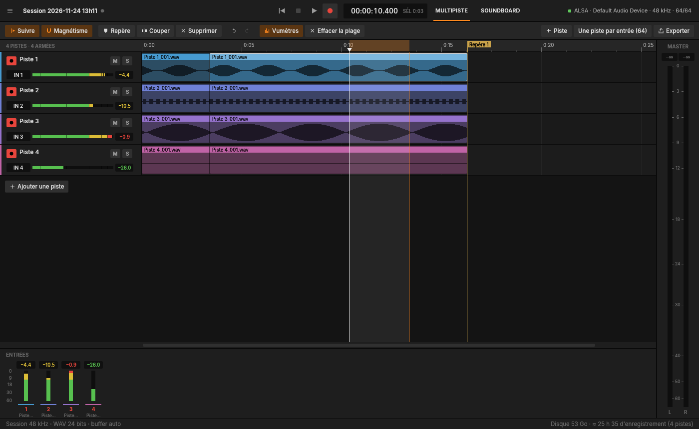

# TracksPlus

Enregistreur **multipiste** et **soundboard** dans une seule application. Interface sombre,
plate et dense, dans l'esprit des stations audio modernes (Bitwig) : gris anthracite, accent
orange, angles quasi droits, couleurs de pistes désaturées.
Pensé pour le live : Dante Virtual Soundcard (jusqu'à 64 entrées et plus), ASIO, CoreAudio.

| Multipiste | Soundboard |
| --- | --- |
|  |  |

## Onglet Multipiste

- **Carte son** : pilote (ASIO / WASAPI, CoreAudio, ALSA / JACK), entrée, sortie, fréquence,
  buffer. Configuration mémorisée : on retrouve sa carte Dante au lancement.
- **Pistes** : une piste = une entrée mono. Sélecteur d'entrée en grille (1 à 64+, entrées déjà
  utilisées signalées). « 1 piste / entrée » crée d'un coup les pistes d'un profil Dante.
  Armement, **M**ute / **S**olo pour l'écoute, renommage direct.
- **Vumètres pro** : crête façon IEC 60268-18 (échelle dB non linéaire, plus précise près de 0),
  zones vert / jaune (−12 dB) / rouge (−3 dB), maintien de crête, valeur crête max en dB et
  voyant de saturation (clic pour remettre à zéro). Un vumètre par piste, un **vumètre master**
  stéréo, et un **bandeau de vumètres** affichant toutes les entrées d'un coup.
- **Enregistrement** : WAV mono 24 bits ou 32 bits flottant écrit directement sur disque
  (en-têtes mis à jour toutes les 2 s : fichiers lisibles même après un crash), sauvegarde
  automatique à chaque stop, temps d'enregistrement restant sur le disque, écoute des pistes
  existantes pendant la prise.
- **Navigation** : la timeline **suit** la tête de lecture en continu ; si vous faites défiler
  pendant la lecture ou l'enregistrement, le suivi se met en pause 3 s puis recadre
  automatiquement (y compris verticalement sur les pistes en cours d'enregistrement).
  Clic sur la règle / une piste = se déplacer (même en lecture), glisser = sélectionner une
  plage, double-clic sur une prise = sélectionner la prise, barre de défilement horizontale.
- **Montage** : cliquer une prise pour la sélectionner (Ctrl pour en ajouter), la **glisser**
  pour la déplacer (y compris vers une autre piste), **rogner** en tirant ses bords,
  **couper** à la tête de lecture (S), **supprimer** (Suppr) les prises sélectionnées ou tout le
  contenu d'une plage de temps. **Magnétisme** sur la tête de lecture, les repères, la sélection
  et les bords des autres prises (Maj pour le désactiver). **Annuler / Rétablir** (Ctrl+Z,
  Ctrl+Maj+Z). Le montage est non destructif : les fichiers enregistrés ne sont jamais modifiés.
- **Fondus sur les prises** : poignées blanches aux coins supérieurs de chaque prise à tirer
  pour régler le fondu d'entrée et de sortie (courbe en S, sans clic), ou clic droit →
  fondus 10 ms / 100 ms / 1 s sur la sélection. Deux prises qui se chevauchent avec un fondu
  font un fondu enchaîné. Les fondus s'appliquent à l'écoute comme à l'export.
- **Repères** (touche M, même pendant l'enregistrement) : renommer, supprimer, sélectionner
  jusqu'au repère suivant, flèches ← / → pour sauter de repère en repère.
- **Export** : pistes **choisies une à une** (ou la sélection de la timeline), toute la
  session ou **seulement la plage sélectionnée**, pistes séparées et/ou mix stéréo,
  44.1 / 48 / 88.2 / 96 kHz, 16 bits (dither TPDF) / 24 bits / 32 bits entier / 32 bits flottant.

## Onglet Soundboard

- **Pads** en grille (4×2 à 8×8), jusqu'à 8 pages. Glissez-déposez des fichiers (WAV, AIFF,
  MP3, AAC/M4A, FLAC, OGG) ou cliquez sur un pad vide. Déclenchement à l'appui (pas au
  relâchement) pour la réactivité.
- **Deux modes**, réglables pour toute la page en un clic ou pad par pad :
  - **Lecture-Stop** : un appui lance le son, un nouvel appui l'arrête (icône ■ sur le pad) ;
  - **Maintenir** : le son joue tant que le pad (souris, touche ou pad MIDI) est tenu et
    s'arrête au relâchement.
  Option de lecture en boucle.
- **Éditeur** : forme d'onde zoomable, poignées **début / fin**, poignées de **fondu d'entrée
  et de sortie** (courbes douces), gain en dB, couleur, nom.
- **Contrôleur USB** : choix du port MIDI (ou tous), **MIDI learn** par pad (notes et CC),
  déclenchement direct dans le thread audio : fonctionne même fenêtre réduite.
  **Touches clavier** assignables par pad (pratique aussi avec un Stream Deck).
- **LED du contrôleur** : les pads associés en MIDI s'allument (couleur du pad sur Launchpad,
  pulsation pendant la lecture ; jaune / vert clignotant sur APC mini ; on/off sur les
  autres). Détection automatique du modèle et de la sortie MIDI correspondante, réglable
  dans le menu « LED ».
- **Ranger les pads** : bouton « Déplacer » (ou Alt + glisser) puis glisser un pad sur une
  autre case (échange si elle est occupée) ou sur un onglet de page pour l'y envoyer.
- **Sortie dédiée** (ex. sorties 3–4 de la Dante), volume général, vumètre stéréo des pads,
  **Tout arrêter** avec fondu (Échap). Le soundboard est sauvegardé automatiquement et peut
  être enregistré / rechargé comme fichier.

## Fiabilité en live

Conçu pour ne jamais perdre une prise :

- **Écriture directe sur disque** par un thread dédié, tampon de 4 s par piste ; le callback
  audio n'alloue ni ne libère jamais de mémoire et ne prend aucun verrou. Testé à 64 pistes
  48 kHz en temps réel sans aucune perte.
- **Si le disque prend du retard**, les trames manquantes sont remplacées par du silence au
  même endroit : la piste ne se décale jamais par rapport aux autres. Alerte immédiate.
- **En-têtes WAV mis à jour toutes les 2 s, données forcées sur le disque toutes les 10 s.**
- **Prises longues** : au-delà de 2 Go, la prise continue sans coupure dans `nom_p2.wav`,
  `nom_p3.wav`… (un WAV ne peut pas dépasser 4 Go), posés bout à bout dans la session.
- **Récupération après crash ou coupure** : la session et un journal des prises sont écrits
  avant le lancement de l'enregistrement. Si l'application est tuée en pleine prise, elle
  rouvre la session au redémarrage, répare les fichiers (en-têtes recalés sur la taille
  réelle) et replace les prises sur la timeline.
- **À l'arrêt**, tout ce qui reste dans les tampons est écrit, les fichiers sont fermés et la
  session sauvegardée immédiatement.
- **Pas d'arrêt accidentel** : pendant une prise, Espace / R / le bouton Rec demandent une
  confirmation (second appui) ; fermer la fenêtre demande confirmation ; changer de carte son
  ou exporter est bloqué.
- **Alertes en direct** (bandeau rouge) : plus de signal de la carte (horloge Dante, câble),
  erreur disque, disque presque plein, saturation disque, erreur du pilote.
- **Pas de mise en veille** de l'ordinateur pendant une prise.
- **Une erreur d'interface n'arrête jamais l'audio** (rattrapée, journalisée dans
  `crash.log` du dossier de configuration). Sauvegarde automatique du montage toutes les 30 s.
- Sons du soundboard limités à 30 min (chargés en mémoire).

## Raccourcis

| Touche | Multipiste | Soundboard |
| --- | --- | --- |
| Espace | Lecture / Stop (pendant une prise : deux appuis) | |
| R | Enregistrer (pendant une prise : deux appuis pour arrêter) | |
| M | Ajouter un repère | |
| ← / → | Repère précédent / suivant | |
| Origine / Entrée | Début (ou début de la sélection) | |
| F | Tout afficher | |
| S | Couper à la tête de lecture | |
| Suppr | Supprimer la sélection | |
| Ctrl + Z / Ctrl + Maj + Z | Annuler / Rétablir | |
| Échap | Effacer les sélections | Tout arrêter |
| Ctrl + molette | Zoom | Zoom de l'éditeur |
| Maj + molette | Défiler dans le temps | |
| Ctrl + 1 / Ctrl + 2 | Changer d'onglet | Changer d'onglet |
| Ctrl + S / Ctrl + E | Enregistrer / Exporter | |

## Utilisation avec Dante

1. Réglages carte son (pastille en haut à droite) → pilote **ASIO** (Windows) ou **CoreAudio**
   (macOS) → **Dante Virtual Soundcard**. Fréquence identique à Dante Controller.
2. Multipiste : « 1 piste / entrée », renommez, armez, ⏺.
3. Soundboard : choisissez la paire de sorties Dante dédiée aux pads.

## Compiler

Prérequis : [Rust](https://rustup.rs) stable.

```sh
# Windows avec ASIO (Dante VSC) — télécharge le SDK Steinberg, nécessite LLVM/clang
cargo build --release --features asio
# macOS / Linux (Linux : libasound2-dev)
cargo build --release
```

La CI GitHub (`.github/workflows/build.yml`) produit un `.exe` Windows (ASIO) et une `.app`
macOS universelle. Police : [Inter](https://rsms.me/inter/) (licence OFL, `assets/fonts`).

## Architecture

| Fichier | Rôle |
| --- | --- |
| `src/audio.rs` | Périphériques, flux cpal, callbacks temps réel (sans allocation ni verrou), vumètres |
| `src/sampler.rs` | Moteur des pads (voix, fondus, modes) exécuté dans le callback de sortie |
| `src/soundboard.rs` | Modèle du soundboard, décodage (symphonia) et rééchantillonnage des sons |
| `src/midi.rs` | Contrôleurs MIDI, déclenchement direct vers le moteur audio |
| `src/recorder.rs` / `src/player.rs` | Threads disque : enregistrement et lecture multipiste |
| `src/render.rs` / `src/export.rs` | Lecture des prises, formes d'onde, export |
| `src/project.rs` | Session, pistes, prises, repères |
| `src/app.rs`, `src/ui/*` | Interface (egui) : thème, widgets, onglets |
