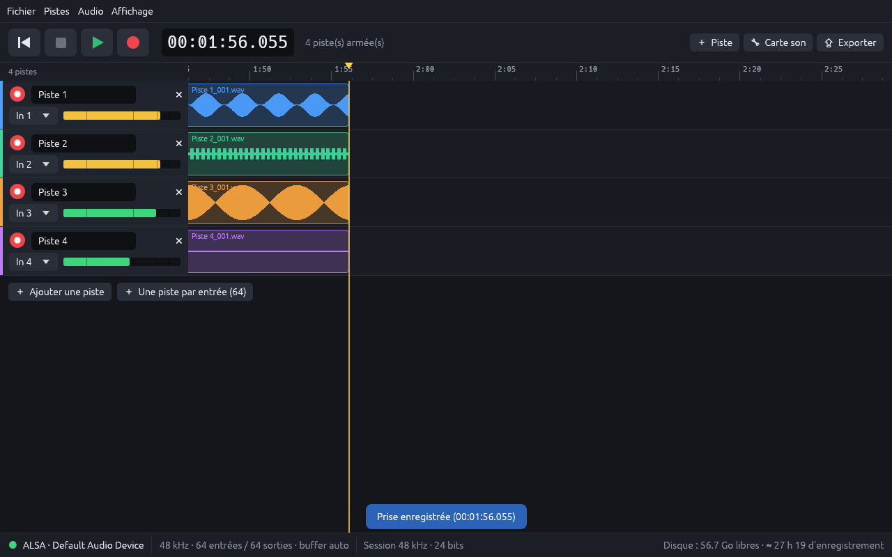

# TracksPlus

Enregistreur multipiste simple et efficace : on choisit sa carte son (Dante Virtual
Soundcard, ASIO, CoreAudio…), on crée ses pistes, on arme, on enregistre, on exporte.
Pas d'effets, pas de faders, pas de mixage : juste du multipiste fiable.



## Fonctions

- **Carte son** : choix du pilote (ASIO / WASAPI sous Windows, CoreAudio sous macOS,
  ALSA / JACK sous Linux), de l'entrée, de la sortie d'écoute, de la fréquence et du buffer.
  La configuration est mémorisée : au prochain lancement on retrouve sa carte (ex. Dante).
- **Pistes** : une piste = une entrée mono de la carte. Bouton « Une piste par entrée »
  pour créer d'un coup les 32/64 pistes d'un profil Dante. Nom, entrée, armement, vumètre.
- **Enregistrement** : écriture directe sur disque en WAV mono 24 bits ou 32 bits flottant,
  un fichier par piste et par prise (`Audio/Piste 1_001.wav`…). L'en-tête est mis à jour
  toutes les 2 s : les fichiers restent lisibles même en cas de crash. Sauvegarde automatique
  de la session à chaque stop. Indicateur de place disque restante en heures d'enregistrement.
- **Lecture** des pistes enregistrées (somme sur une paire de sorties au choix), y compris
  pendant un nouvel enregistrement (overdub).
- **Export** : pistes séparées (stems mono alignés au début de la session) et/ou mix stéréo,
  en 44.1 / 48 / 88.2 / 96 kHz et 16 bits (avec dither) / 24 bits / 32 bits entier /
  32 bits flottant. Conversion de fréquence de haute qualité.

## Raccourcis

| Touche | Action |
| --- | --- |
| Espace | Lecture / Stop |
| R | Enregistrer / Stop |
| Origine ou Entrée | Retour au début |
| Fin | Aller à la fin |
| F | Tout afficher |
| Ctrl + molette | Zoom |
| Maj + molette | Défiler dans le temps |
| Ctrl + S | Enregistrer la session |
| Clic droit sur une prise | Supprimer la prise |

## Utilisation avec Dante

- **Windows** : Audio ▸ Réglages → pilote **ASIO** → entrée **Dante Virtual Soundcard**.
  La fréquence doit correspondre à celle réglée dans Dante Controller / DVS.
- **macOS** : pilote **CoreAudio** → **Dante Virtual Soundcard**.
- Puis Pistes ▸ « Une piste par entrée de la carte », renommez vos pistes, armez, ⏺.

## Compiler

Prérequis : [Rust](https://rustup.rs) stable.

```sh
# Windows, avec ASIO (nécessaire pour Dante VSC en ASIO ; télécharge le SDK Steinberg,
# nécessite LLVM/clang installé)
cargo build --release --features asio

# macOS / Linux
cargo build --release
# Linux : paquets libasound2-dev (+ libjack-dev avec --features jack)
```

Le binaire est dans `target/release/`. La CI GitHub (`.github/workflows/build.yml`)
produit un `.exe` Windows (ASIO) et une `.app` macOS universelle à chaque push.

## Structure d'une session

```
Ma session/
├── Ma session.tracksplus   (JSON : pistes, entrées, prises)
├── Audio/                  (WAV mono enregistrés)
└── Export/                 (fichiers exportés)
```

## Architecture

| Fichier | Rôle |
| --- | --- |
| `src/audio.rs` | Périphériques, flux cpal, callbacks temps réel (sans allocation ni verrou) |
| `src/recorder.rs` | Thread disque : ring buffers → WAV, formes d'onde en direct |
| `src/player.rs` | Thread de lecture : prises → mix stéréo → sortie |
| `src/render.rs` | Lecture des prises sur disque, formes d'onde |
| `src/export.rs` | Export stems / mix, rééchantillonnage, dither |
| `src/project.rs` | Modèle de session et sauvegarde |
| `src/app.rs`, `src/theme.rs` | Interface (egui) |
